

  

<b>A mobile operating system for hardware you can buy today, with its roots in Symbian.</b>

  <a href="https://github.com/Phorepoc/adaptation-pc/releases/latest">Try it in VirtualBox</a> ·
  <a href="https://github.com/Phorepoc/adaptation-pinephone/releases/latest">On a PinePhone</a> ·
  <a href="https://github.com/Phorepoc/pdk">Build it</a>

---

**Phorepoc OS** is an open-source operating system for phones and PCs. It grew out of Symbian, the system that ran on
hundreds of millions of phones. In 2010 Nokia and the Symbian Foundation released Symbian's source code and then shut
the project down, and that code sat untouched for years.

We started from that source, and build it with a modern compiler. Phorepoc OS runs on any x86-64 PC or virtual machine
and on the PINE64 PinePhone, with the Symbian^3 interface and its apps, networking with modern TLS, and OpenGL ES on the
GPU through Mesa. It runs apps made for Symbian^3, and it keeps going where Symbian stopped: Catalogue for apps, drivers
and codecs, a developer shell, a modern web engine.

Phorepoc does two things at once. It **preserves** Symbian: the 2010 source builds again, and apps made for Symbian^3
keep running. And it **evolves** it: new interfaces, modern software (TLS 1.3, current web engines, OpenGL ES, Qt and
GTK ports), new hardware, and an app store, added in a way that keeps those older apps working.

Phorepoc is the whole project around it: the operating system, the tools to build and debug it (the pdk and PhoneLab),
and services like the Cloud Companion.

  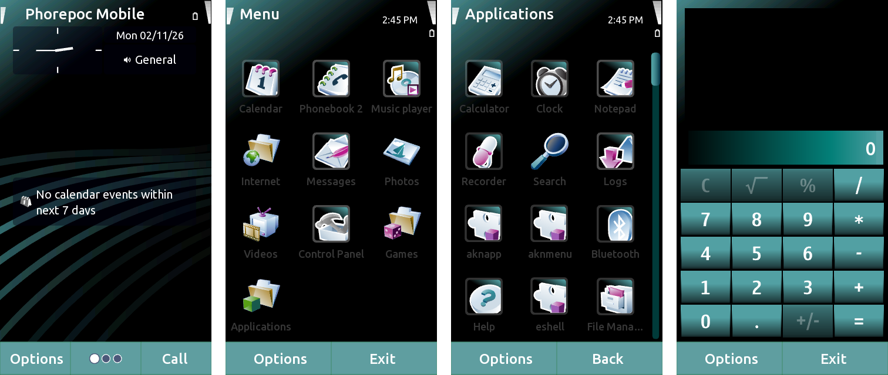
   Phorepoc OS on a PinePhone, in the built-in Haze theme.

<table>
  <tr>
    <td>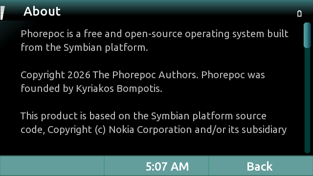</td>
    <td>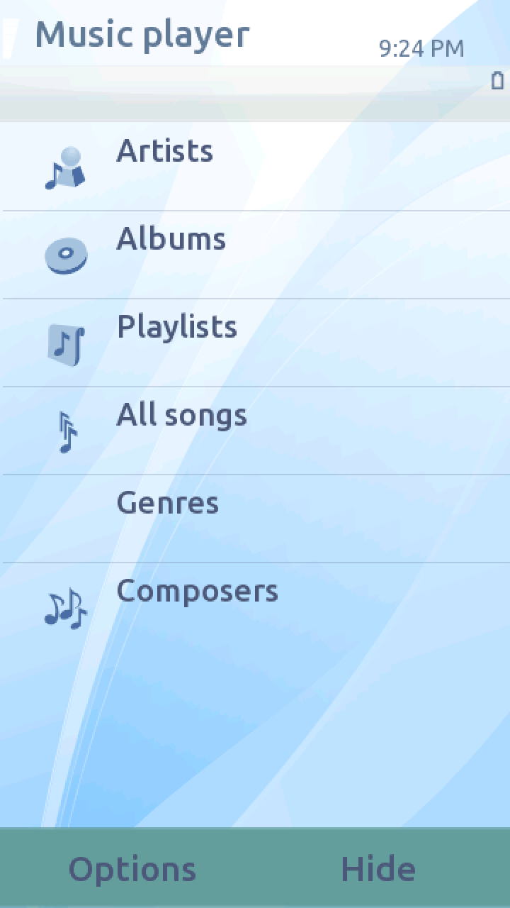</td>
  </tr>
  <tr>
    <td align="center">About.</td>
    <td align="center">Music player.</td>
  </tr>
</table>

## The operating system and devices

- [**Phorepoc OS for PCs**](https://github.com/Phorepoc/adaptation-pc) : a VirtualBox appliance and a bootable ISO for QEMU and real PCs. The easiest way to try it.
- [**Phorepoc OS for the PinePhone**](https://github.com/Phorepoc/adaptation-pinephone) : a microSD card image. Boot Phorepoc OS on the phone, take the card out and its own system is back.
- [**core**](https://github.com/Phorepoc/core): everything that is the same on every device, built for an architecture, never for a device.
- [**adaptation-x32**](https://github.com/Phorepoc/adaptation-x32) and [**adaptation-a64**](https://github.com/Phorepoc/adaptation-a64): the kernel on x86-64 (64-bit CPU, 32-bit pointers, SMP) and the Allwinner A64 drivers shared by every A64 board.
- [**tls**](https://github.com/Phorepoc/tls): TLS 1.2 and 1.3 through mbedTLS, built into Phorepoc OS and usable as a drop-in on older Symbian phones.
- [**mesa-symbian**](https://github.com/Phorepoc/mesa-symbian): OpenGL ES 1.1/2.0 and EGL through Mesa, in software on any board or on the Mali-400 GPU of the A64.

## Catalogue and apps

- [**Catalogue**](https://github.com/Phorepoc/catalogue) : the software store. It reads the index, shows what's there by category with search, checks each download's SHA-256 and installs it. Drivers, codecs, web engines and apps get onto a device this way, not by being built into the image.
- [**index**](https://github.com/Phorepoc/index): the list of software Catalogue offers. Add yours with a pull request.
- [**webengine**](https://github.com/Phorepoc/webengine): the plug-in interface between the browser and its web engines. The browser draws pages with whichever engine you install from Catalogue:
  - [**webkit-symbian**](https://github.com/Phorepoc/webkit-symbian) : WPE WebKit 2.54 with JavaScriptCore, behind the browser-control API apps have used since 2010.
  - [**netsurf-symbian**](https://github.com/Phorepoc/netsurf-symbian) : NetSurf, a small, fast engine with https and JavaScript (QuickJS-ng), for devices with little memory.
- [**codecpack**](https://github.com/Phorepoc/codecpack) : FFmpeg and OpenH264 video and AAC support, installed from Catalogue.

<table>
  <tr>
    <td>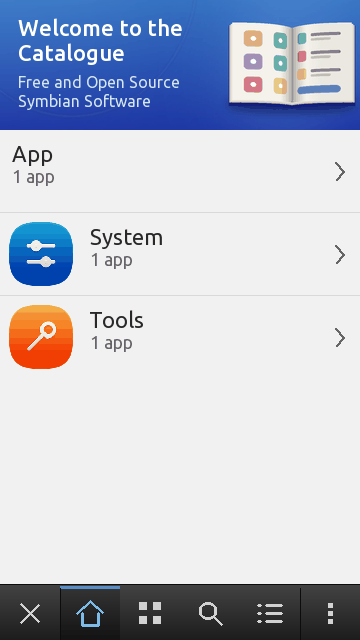</td>
    <td>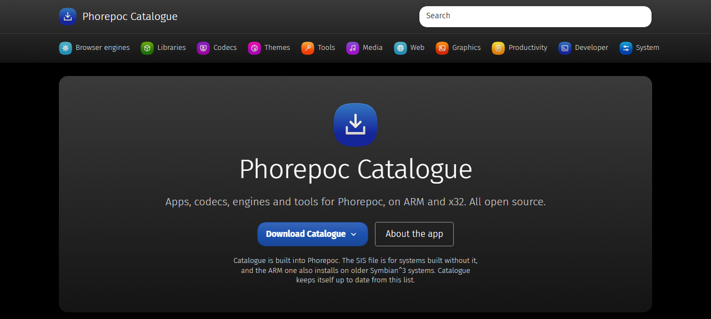</td>
  </tr>
  <tr>
    <td align="center">Catalogue on the phone.</td>
    <td align="center">The <a href="https://phorepoc.github.io/index/">Catalogue website</a>.</td>
  </tr>
  <tr>
    <td>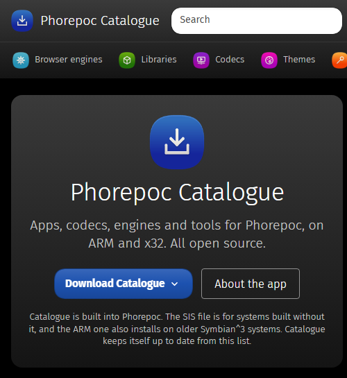</td>
    <td>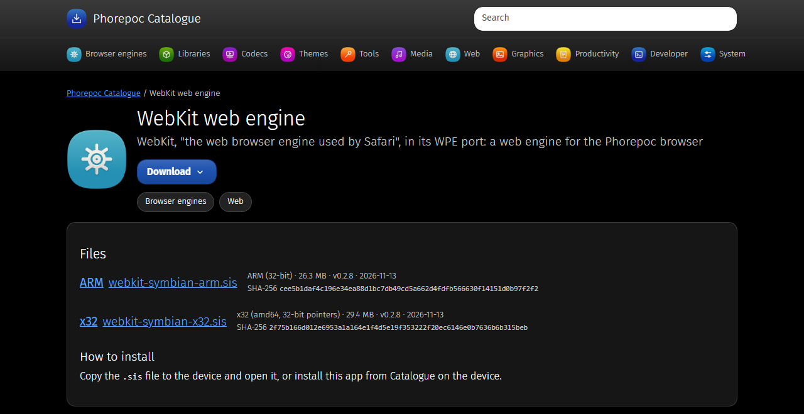</td>
  </tr>
  <tr>
    <td align="center">The website on a phone.</td>
    <td align="center">A listing, with each file's SHA-256.</td>
  </tr>
</table>

## Compatibility

- [**Proteus**](https://github.com/Phorepoc/proteus) : runs ARM Symbian programs on the PC edition. An app installed from an ARM SIS starts like any other; Proteus runs its ARM code in user space, with the program's own SecureId and capabilities.
- [**qt-symbian**](https://github.com/Phorepoc/qt-symbian) : Qt 4.8.7, so Qt apps made for Symbian^3 keep running. A Catalogue package, never part of an image.
- [**cxxrt**](https://github.com/Phorepoc/cxxrt): the modern C++ runtime (libstdc++, C++17/20) and the POSIX functions ported libraries need.

## Interfaces

Phorepoc OS starts with the Symbian^3 interface. Other shells install from Catalogue and are chosen in Settings, Device, UI shell.

- [**etesian-ui**](https://github.com/Phorepoc/etesian-ui): Etesian, a new home screen, app grid and open-apps view in a design language inspired by the N9, for the Symbian^3 UI.
- [**hildon-ui**](https://github.com/Phorepoc/hildon-ui) : the Maemo / Leste Hildon widgets and home and status plug-ins, on [**gtk-symbian**](https://github.com/Phorepoc/gtk-symbian)  (GTK 2), [**glib-symbian**](https://github.com/Phorepoc/glib-symbian)  and [**dbus-symbian**](https://github.com/Phorepoc/dbus-symbian) , with the [**hildon-theme-alpha**](https://github.com/Phorepoc/hildon-theme-alpha)  theme.
- [**orbit-ui**](https://github.com/Phorepoc/orbit-ui) : Orbit, the Hb interface and Qt home screen of Symbian^4, published in 2010 and never shipped on a phone. On the PC edition for now.
- [**clutter-symbian**](https://github.com/Phorepoc/clutter-symbian): Clutter and Cogl on OpenGL ES. The libraries build and a test program draws a Clutter stage; not released yet.

<table>
  <tr>
    <td>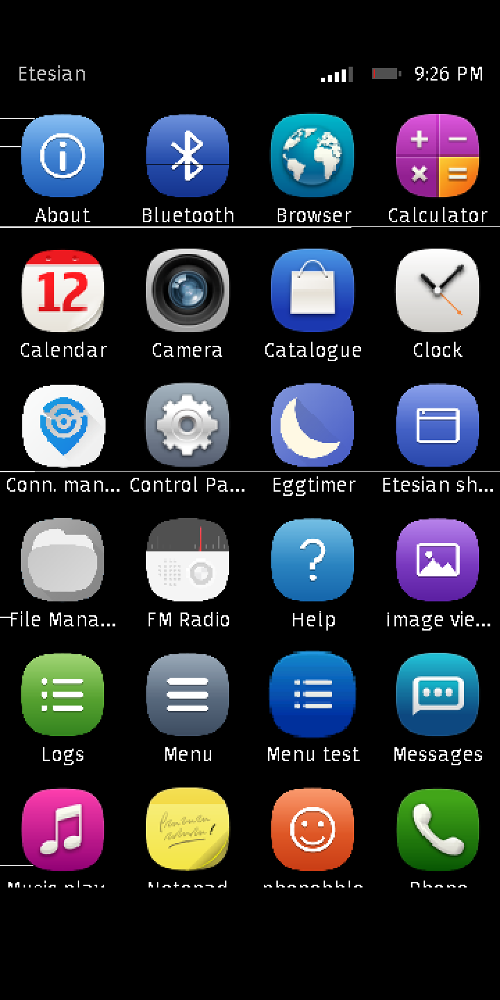</td>
    <td>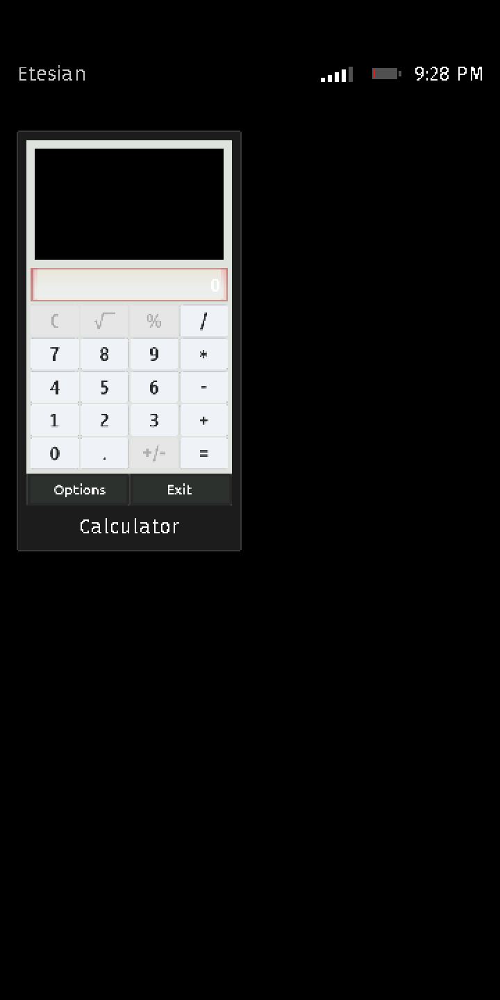</td>
  </tr>
  <tr>
    <td align="center">The Etesian app grid.</td>
    <td align="center">Etesian's open apps, with a live preview.</td>
  </tr>
  <tr>
    <td>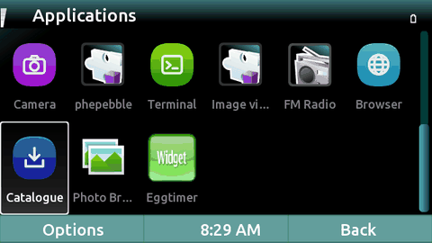</td>
    <td>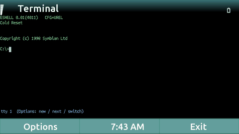</td>
  </tr>
  <tr>
    <td align="center">The Symbian^3 Applications folder, landscape, on the PC edition.</td>
    <td align="center">Terminal, the developer shell, on the PC edition.</td>
  </tr>
</table>

## The developer kit

- [**pdk**](https://github.com/Phorepoc/pdk) : `phe` builds Phorepoc OS from source (components, resources, ROMs, skins, icons, SIS packages), and PhoneLab puts a running phone's screen, files and log in your browser.
- [**toolchain**](https://github.com/Phorepoc/toolchain): the Linux build images: GCC x32, Arm GNU 14.2 and the Symbian host tools built from the 2010 source.

## Beyond Phorepoc

- [**Cloud Companion**](https://github.com/Phorepoc/cloud-companion) : a server you run yourself that brings the modern internet to legacy phones: a cloud browser, your mail, messages and calendar.

  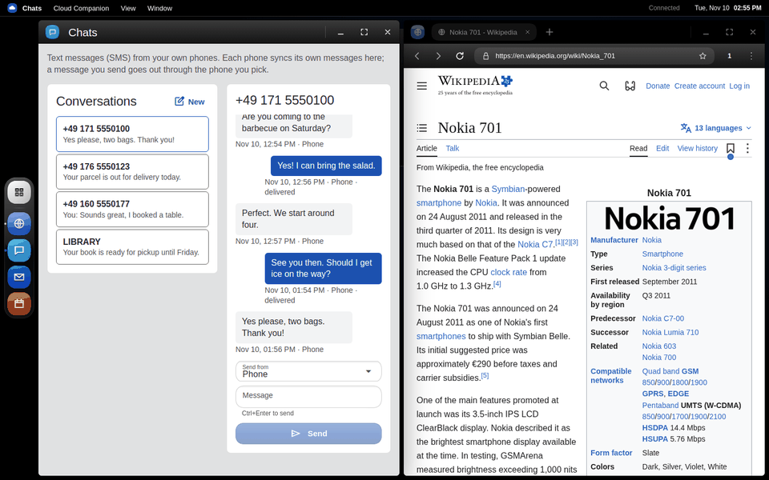
   Cloud Companion: a desktop in your browser, with your messages, files and the cloud browser in overlapping windows.

- [**dav-sync**](https://github.com/Phorepoc/dav-sync): syncs contacts and calendars with any CalDAV or CardDAV server, in small C99.
- [**tailscale-symbian**](https://github.com/Phorepoc/tailscale-symbian): a small Tailscale client in plain C99. An early prototype.

## PhoneLab

  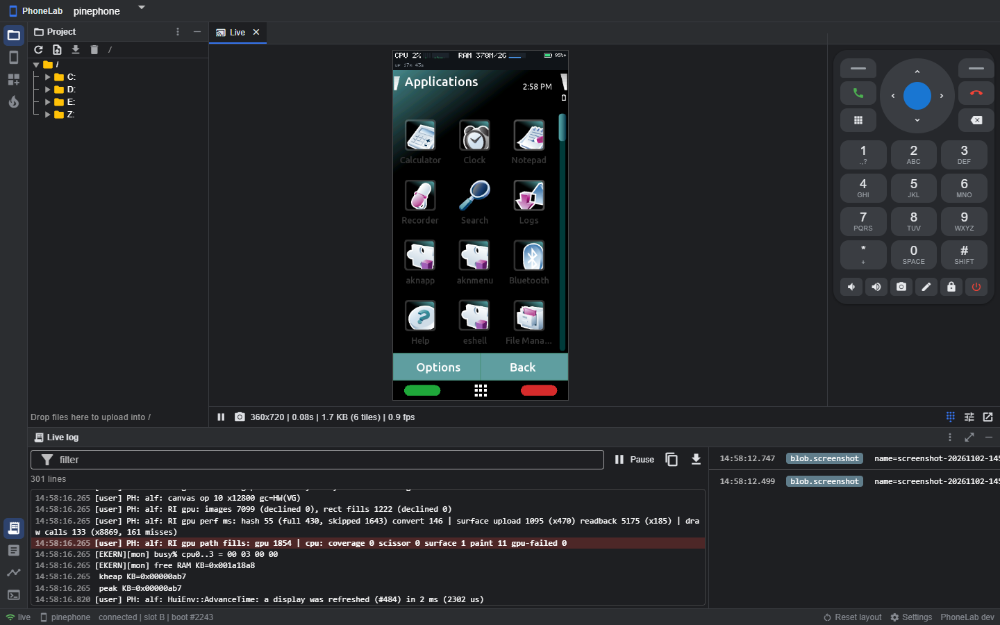

Every Phorepoc OS development image has a debug link, and PhoneLab turns it into a workbench in your browser: the live screen you can
tap on, one-step flashing with a report of each boot, the full log of every boot, the phone's files and a shell, and a
REST API and MCP server so scripts and AI agents can do all of it too. It runs anywhere with one `docker run`, and it
works with stock Nokia Symbian phones as well. See the [pdk](https://github.com/Phorepoc/pdk).

## Where it is heading

These are plans, not features yet:

- **Native resolution.** Run at the display's real size (720x1440 on the PinePhone) instead of doubling every pixel,
  with a compatibility mode that keeps S60 apps at the size they were made for.
- **Sharper layouts.** Layout packs for high-density screens, so the Symbian^3 interface is drawn at full resolution.
- **Resizable windows on the PC.** Changing the resolution at run time, with S60 apps in framed windows.
- **Wider compatibility.** Proteus and Qt keep growing so more existing Symbian software runs unchanged.

## Try it

The easiest way is VirtualBox. Download the `.ova` file from the
[latest PC release](https://github.com/Phorepoc/adaptation-pc/releases/latest) and import it with
**File > Import Appliance**.

If you have a PinePhone, download `phorepoc-pinephone-sdcard.img.xz` from the
[latest PinePhone release](https://github.com/Phorepoc/adaptation-pinephone/releases/latest) and write it to a microSD
card with [balenaEtcher](https://etcher.balena.io).

Where things are

Phorepoc OS is built in layers, and each repository only knows about the ones below it:

| Layer | Repositories |
|---|---|
| Boards: one device each | [adaptation-pc](https://github.com/Phorepoc/adaptation-pc), [adaptation-pinephone](https://github.com/Phorepoc/adaptation-pinephone) |
| Chips: kernel ports and drivers | [adaptation-x32](https://github.com/Phorepoc/adaptation-x32), [adaptation-a64](https://github.com/Phorepoc/adaptation-a64) |
| Optional layers | [tls](https://github.com/Phorepoc/tls), [mesa-symbian](https://github.com/Phorepoc/mesa-symbian), [cxxrt](https://github.com/Phorepoc/cxxrt), [webkit-symbian](https://github.com/Phorepoc/webkit-symbian), [codecpack](https://github.com/Phorepoc/codecpack) |
| The operating system | [core](https://github.com/Phorepoc/core), built for an architecture, never for a device |
| The tools | [pdk](https://github.com/Phorepoc/pdk) (the `phe` command, PhoneLab, the CI pipeline) and [toolchain](https://github.com/Phorepoc/toolchain) (the compilers) |

So bringing Phorepoc OS to a new device means writing a board repository, plus a chip repository if nobody has done
that chip yet. You don't change core or the pdk. The pdk's
[docs/layering.md](https://github.com/Phorepoc/pdk/blob/main/docs/layering.md) explains how.

If you're curious about where it all started, [symbian-2010](https://github.com/Phorepoc/symbian-2010) is the 2010 release with
as few changes as possible, booting in the Symbian QEMU from [qemu-syborg](https://github.com/Phorepoc/qemu-syborg).
The `oss.*` repositories are untouched mirrors of the 2010 source packages.

## Licences and contributing

Code we wrote is Apache-2.0. Symbian files we've changed are EPL-2.0, with GPL-2.0-or-later as a Secondary License, and
Symbian files we use unchanged stay EPL-1.0. Ported projects keep their own licences: Mesa is MIT, mbedTLS is
Apache-2.0 and FFmpeg is LGPL.

Phorepoc was started by Kyriakos Bompotis. Contributions are very welcome, and each repository's README explains how to
get going.

Phorepoc is an independent project, not affiliated with Nokia or the Symbian Foundation, and ships no Nokia
firmware files.
