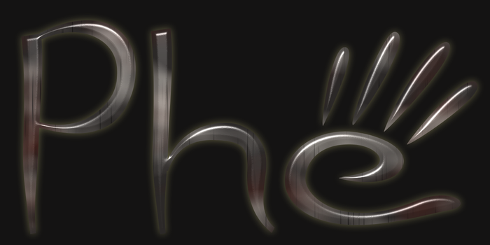
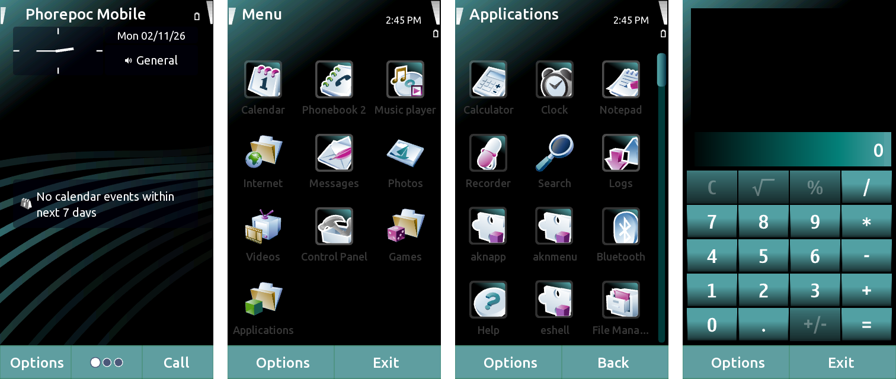
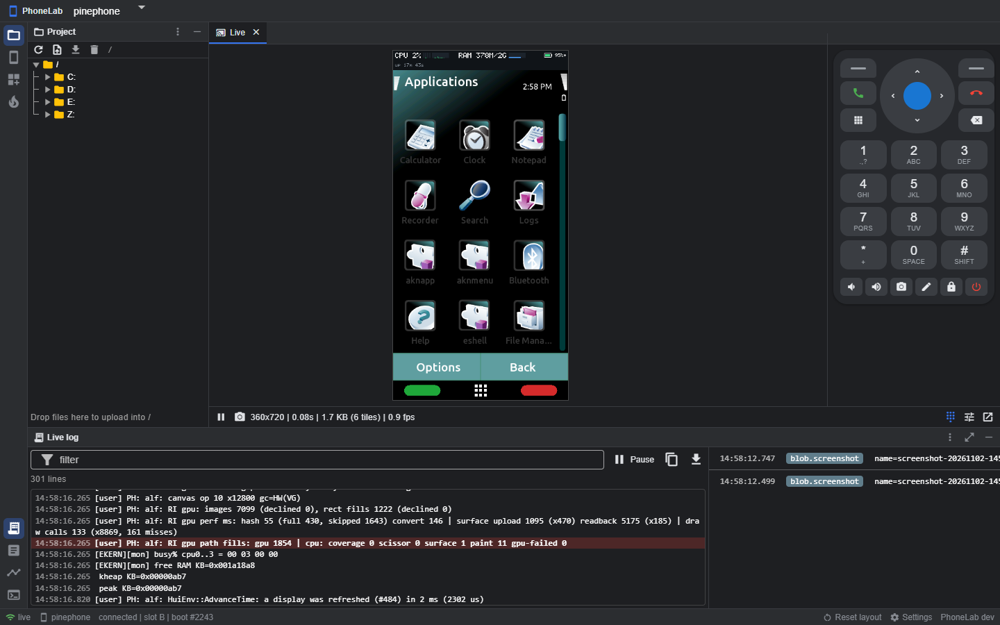

  

<b>Symbian, back on hardware you can buy today.</b>

  <a href="https://github.com/Phorepoc/adaptation-pc/releases/latest">Try it in VirtualBox</a> ·
  <a href="https://github.com/Phorepoc/adaptation-pinephone/releases/latest">On a PinePhone</a> ·
  <a href="https://github.com/Phorepoc/pdk">Build it</a>

---

In 2010 Nokia and the Symbian Foundation released the source code of Symbian, the operating system that ran on hundreds
of millions of phones. Then the project was shut down, and that code has sat untouched ever since.

Phorepoc picks it back up. We build that source with a modern compiler and run it on any x86-64 PC or virtual machine,
and on the PINE64 PinePhone: the full Symbian^3 interface with its own apps, networking with modern TLS, OpenGL ES on
the GPU through Mesa, and a few things we've added along the way, like Catalogue (apps, drivers and codecs) and a
developer shell.

  
   Phorepoc on a PinePhone, in the built-in Haze theme.

| Project | What it is |
|---|---|
| [**Phorepoc for PCs**](https://github.com/Phorepoc/adaptation-pc) | A VirtualBox appliance and a bootable ISO for QEMU and real PCs. The easiest way to try it. |
| [**Phorepoc for the PinePhone**](https://github.com/Phorepoc/adaptation-pinephone) | A microSD card image: boot Symbian on the phone, take the card out and its own system is back. |
| [**PDK and PhoneLab**](https://github.com/Phorepoc/pdk) | `phe` builds Phorepoc from source; PhoneLab puts a running phone's screen, files and log in your browser, for people and AI agents alike. |
| [**Cloud Companion**](https://github.com/Phorepoc/cloud-companion) | A server you run yourself that brings the modern internet to legacy phones: a cloud browser, your mail, messages and calendar. |

## PhoneLab

  

Every Phorepoc phone has a debug link, and PhoneLab turns it into a workbench in your browser: the live screen you can
tap on, one-step flashing with a report of each boot, the full log of every boot, the phone's files and a shell, and a
REST API and MCP server so scripts and AI agents can do all of it too. It runs anywhere with one `docker run`, and it
works with stock Nokia Symbian phones as well. See the [pdk](https://github.com/Phorepoc/pdk).

## Try it

The easiest way is VirtualBox. Download the `.ova` file from the
[latest PC release](https://github.com/Phorepoc/adaptation-pc/releases/latest) and import it with
**File > Import Appliance**.

If you have a PinePhone, download the `.img.xz` file from the
[latest PinePhone release](https://github.com/Phorepoc/adaptation-pinephone/releases/latest) and write it to a microSD
card with [balenaEtcher](https://etcher.balena.io).

Where things are

Phorepoc is built in layers, and each repository only knows about the ones below it:

| Layer | Repositories |
|---|---|
| Boards: one device each | [adaptation-pc](https://github.com/Phorepoc/adaptation-pc), [adaptation-pinephone](https://github.com/Phorepoc/adaptation-pinephone) |
| Chips: kernel ports and drivers | [adaptation-x86-64](https://github.com/Phorepoc/adaptation-x86-64), [adaptation-a64](https://github.com/Phorepoc/adaptation-a64) |
| Optional layers | [tls](https://github.com/Phorepoc/tls), [mesa-symbian](https://github.com/Phorepoc/mesa-symbian), [cxxrt](https://github.com/Phorepoc/cxxrt), [webkit-symbian](https://github.com/Phorepoc/webkit-symbian), [codecpack](https://github.com/Phorepoc/codecpack) |
| The operating system | [core](https://github.com/Phorepoc/core), built for an architecture, never for a device |
| The tools | [pdk](https://github.com/Phorepoc/pdk) (the `phe` command, PhoneLab, the CI pipeline) and [toolchain](https://github.com/Phorepoc/toolchain) (the compilers) |

So bringing Phorepoc to a new device means writing a board repository, plus a chip repository if nobody has done
that chip yet. You don't change core or the pdk. The pdk's
[docs/layering.md](https://github.com/Phorepoc/pdk/blob/main/docs/layering.md) explains how.

What the layers do:

- [tls](https://github.com/Phorepoc/tls) gives Symbian TLS 1.2 and 1.3 through mbedTLS. It works on older Symbian phones
  too.
- [mesa-symbian](https://github.com/Phorepoc/mesa-symbian) is the Mesa port behind OpenGL ES.
- [webkit-symbian](https://github.com/Phorepoc/webkit-symbian) and [cxxrt](https://github.com/Phorepoc/cxxrt) are the
  WebKit port and the modern C++ runtime it needs.
- [codecpack](https://github.com/Phorepoc/codecpack) adds FFmpeg and OpenH264 video support. You install it from
  Catalogue.
- [index](https://github.com/Phorepoc/index) is the list of software Catalogue offers.
- [toolchain](https://github.com/Phorepoc/toolchain) has the Docker images everything is built in.
- [webengine](https://github.com/Phorepoc/webengine) is the plug-in interface between the browser and its web engines.

Some projects are useful beyond Phorepoc, for any legacy phone or system:

- [cloud-companion](https://github.com/Phorepoc/cloud-companion) is a server you run yourself that brings the modern
  internet to legacy phones.
- [dav-sync](https://github.com/Phorepoc/dav-sync) syncs contacts and calendars with any CalDAV or CardDAV server.
- [tailscale-symbian](https://github.com/Phorepoc/tailscale-symbian) is a small Tailscale client in plain C99.

If you're curious about the original, [symbian-2010](https://github.com/Phorepoc/symbian-2010) is the 2010 release with
as few changes as possible, booting in the Symbian QEMU from [qemu-syborg](https://github.com/Phorepoc/qemu-syborg).
The `oss.*` repositories are untouched mirrors of the 2010 source packages.

## Licences and contributing

Code we wrote is Apache-2.0. Symbian files we've changed are EPL-2.0, with GPL-2.0-or-later as a Secondary License, and
Symbian files we use unchanged stay EPL-1.0. Ported projects keep their own licences: Mesa is MIT, mbedTLS is
Apache-2.0 and FFmpeg is LGPL.

Phorepoc was started by Kyriakos Bompotis. Contributions are very welcome, and each repository's README explains how to
get going.

Phorepoc is an independent project, not affiliated with Nokia or the Symbian Foundation, and ships no Nokia
firmware files.
